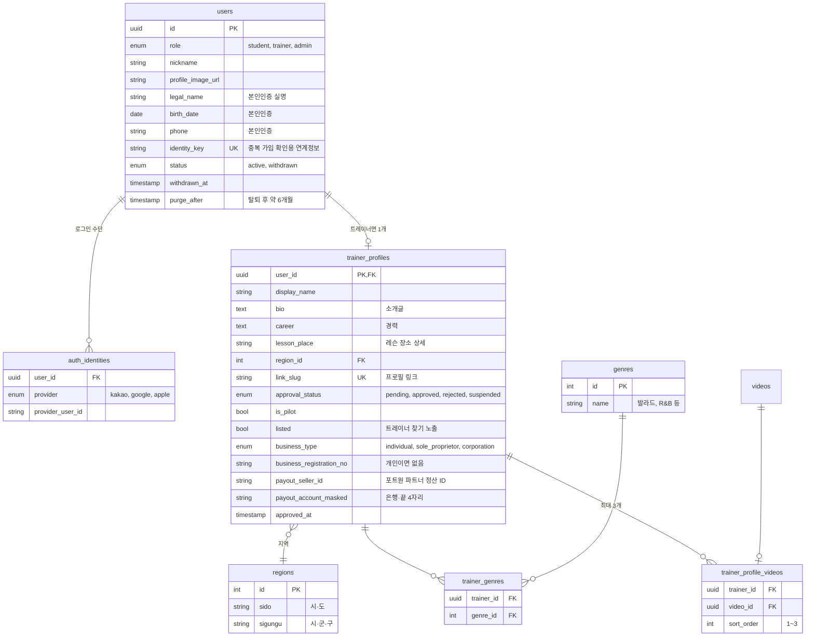
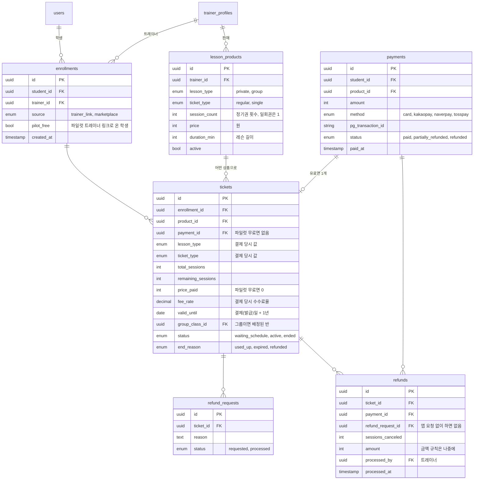
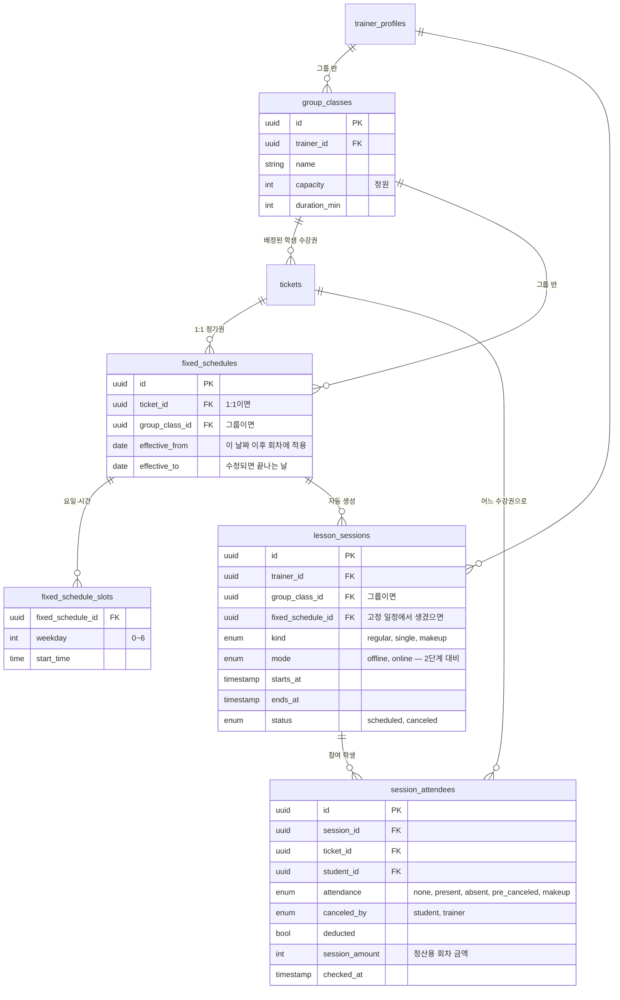
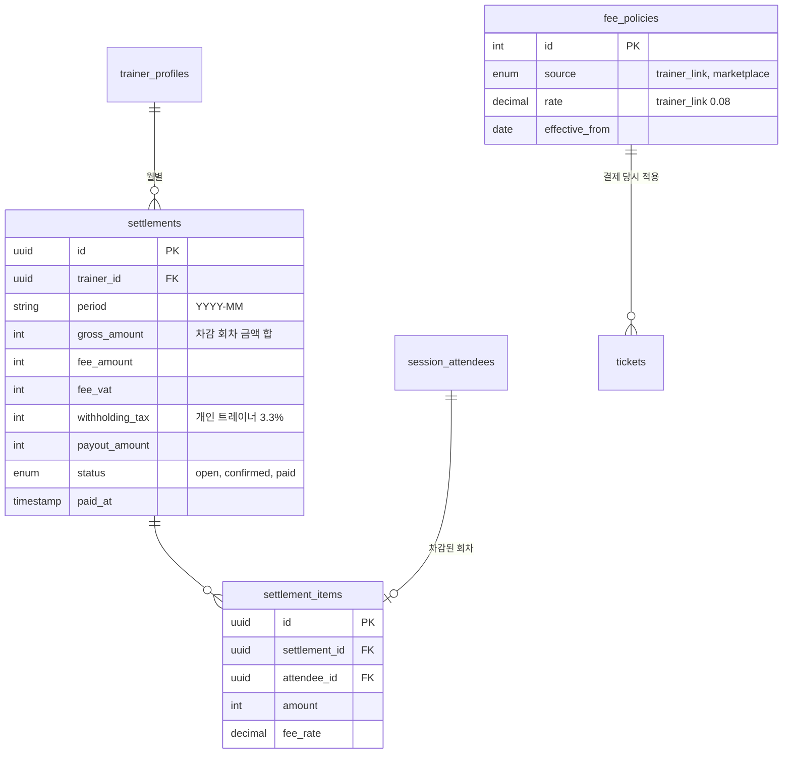
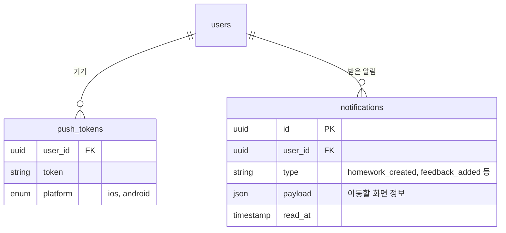

# 보컬 레슨 플랫폼 데이터 모델 (ERD) — 1단계

- 상태: 초안
- 기준 문서: `docs/prd.md`(PR #2), `docs/screens.md`(PR #3). 괄호 안의 `PAY-03` 같은 ID가 그 테이블이 다루는 요구사항이다.
- 이 문서는 논리 모델이다. 어떤 DB를 쓸지, 타입을 정확히 무엇으로 할지는 기술 문서에서 정한다.
- 표기
  - 테이블·컬럼의 영문 이름과 enum 값은 코드(화면, API, DB)에서도 그대로 쓴다.
  - **(제안)**: PRD에 없고 Claude가 채워 넣은 항목.
  - **[결정 n]**: 이 문서 끝 "결정 필요" n번과 연결된 항목.
  - 모든 테이블에는 `id`(PK)와 `created_at`이 있다고 보고, 다이어그램에서는 꼭 필요할 때만 적는다.

## 1. 용어와 영문 이름

| 용어 | 테이블 |
|---|---|
| 사용자 (학생·트레이너·운영자) | `users` |
| 트레이너 프로필 | `trainer_profiles` |
| 레슨 상품 | `lesson_products` |
| 수강 관계 | `enrollments` |
| 결제 | `payments` |
| 수강권 | `tickets` |
| 그룹 반 | `group_classes` |
| 고정 일정 | `fixed_schedules` |
| 레슨 회차 | `lesson_sessions` |
| 회차 참여·출결 | `session_attendees` |
| 숙제 | `homeworks` |
| 연습 영상 제출 | `submissions` |
| 피드백 | `feedback_comments` |
| 영상 (프로필·예시·연습) | `videos` |
| 환불 요청 / 환불 | `refund_requests` / `refunds` |
| 정산 | `settlements`, `settlement_items` |
| 채팅방 (단체·1:1) | `chat_rooms`, `chat_members`, `messages` |
| 후기 | `reviews` |
| 신고 / 차단 | `reports` / `blocks` |

## 2. 계정·트레이너

- 한 계정은 하나의 역할만 가진다(`role`). 운영자 계정도 따로 쓴다. (AUTH-02, PRD 4장)
- 본인인증 결과로 만 19세 미만이면 `users`를 만들지 않는다. (AUTH-03)
- 본인인증 결과 중 실명, 생년월일, 휴대폰 번호, 중복 가입 확인용 연계정보만 저장한다. 저장 범위는 개인정보 처리방침에 적는다.
- 탈퇴하면 `status = withdrawn`, `purge_after = 탈퇴일 + 약 6개월`로 두고, 그날이 지나면 계정 정보와 영상을 지운다. 결제·정산 기록은 법정 기간 동안 남긴다. (AUTH-08)
- 승인 전(`pending`)에는 `link_slug`로 프로필을 열 수 없다. 목록에는 `approved`이면서 `listed = true`인 트레이너만 나온다. (AUTH-05, MKT-01, MKT-07)
- 프로필 영상은 3개까지다. (TRN-07)
- 트레이너의 사업자 유형(`business_type`)을 저장한다. 사업자등록이 없는 개인(`individual`)도 받는다. 사업자이면 사업자등록번호를 함께 저장한다.
- 정산 계좌번호 전체는 저장하지 않는다. 트레이너가 계좌를 입력하면 서버가 PG 지급대행에 셀러로 등록하고, PG가 준 셀러 ID(`payout_seller_id`)와 "은행명·끝 4자리"(`payout_account_masked`)만 저장한다. 매달 지급할 때는 셀러 ID와 금액만 PG에 보낸다. 계좌를 바꾸면 PG에 다시 등록한다. PG별 등록 절차는 계약할 때 확인한다.

## 3. 상품·결제·수강권

- 수강 관계는 학생·트레이너 쌍마다 하나다. 그 트레이너와 처음 결제(파일럿 링크면 가입)할 때 생기고, 그때의 유입 경로를 `source`에 남긴다. (PAY-04, MKT-06)
- 파일럿 무료는 `pilot_free = true`인 수강 관계에만 적용된다. 파일럿 트레이너가 목록으로 받은 학생은 `source = marketplace`, `pilot_free = false`라서 결제한다. (PLT-02, PLT-07)
- 수강권은 결제 당시의 상품 내용(유형, 횟수, 가격)과 수수료율을 복사해 둔다. 트레이너가 나중에 가격을 바꾸거나 수수료율이 바뀌어도 이미 산 수강권은 그대로다. (제안)
- 같은 학생이 같은 트레이너의 1:1과 그룹 수강권을 동시에 가질 수 있다. (PAY-08)
- 정기권은 결제 직후 `waiting_schedule`, 고정 일정이 들어오면 `active`, 횟수 소진·만료·환불이면 `ended`. (PAY-05, 화면 S-06)
- 환불하면 남은 회차가 취소되고 `remaining_sessions`가 0이 된다. 금액 계산 규칙은 나중에 정한다. (PAY-09~11)
- 재결제하면 새 수강권이 생긴다. 1:1이면 기존 고정 일정을 새 수강권에 이어 붙여 회차를 만들고, 그룹이면 같은 그룹 반에 배정한다. (PAY-07)
- 파일럿 무료 수강권은 트레이너가 `is_pilot = true`이고 수강 관계가 `pilot_free = true`일 때만 발급할 수 있다. 파일럿이 해제되면 이미 발급된 수강권은 그대로 쓰고, 새 수강권은 결제해야 한다. (PLT-03, PLT-05)

## 4. 일정·출결

- 그룹 반은 정원(`capacity`)이 차면 학생을 더 배정할 수 없다. 학생은 그룹 수강권을 결제할 수 있고, 트레이너가 자리가 있는 반에 배정한다.
- 고정 일정은 1:1이면 수강권에, 그룹이면 그룹 반에 붙는다. 주 여러 요일은 `fixed_schedule_slots` 여러 줄이다. (SCH-01, TRN-04)
- 고정 일정을 수정하면 기존 일정의 `effective_to`를 수정일로 닫고 새 일정을 만든다. 수정일 이후의 `scheduled` 회차만 지우고 새 일정으로 다시 만든다. 지난 회차와 출결은 그대로 남는다. (SCH-04)
- 회차 하나에 학생이 여러 명일 수 있어서(그룹), 출결은 회차가 아니라 `session_attendees`에 학생별로 둔다. (ATT-03)
- 출결과 차감 (ATT-01, ATT-02)
  - `present`(출석), `absent`(결석), `makeup`(보강): `deducted = true`, 수강권 `remaining_sessions` 1 감소
  - `pre_canceled`(사전 취소): 차감 없음. 학생 취소는 레슨 24시간 전까지만 된다. (SCH-05)
  - 트레이너가 회차를 취소하면 회차 `status = canceled`, 참여 학생 전원 `pre_canceled`. (SCH-06)
- 보강은 `kind = makeup`인 회차다. 그룹 반 학생도 개별 보강 회차로 잡는다. (SCH-08)
- `session_amount`는 차감 시점에 `수강권 price_paid ÷ total_sessions`로 채운다. 정산은 이 값을 모은다. (STL-02)
- 일회권은 `kind = single` 회차 하나다. (SCH-02)

## 5. 숙제·영상·피드백

- 숙제는 회차에 묶이고, 한 회차에 여러 개 낼 수 있다. 받는 학생은 `homework_targets`에 적는다. 1:1이면 한 명, 그룹 전체면 반의 학생 모두, 일부면 고른 학생만. (HW-01, HW-03)
- 예시 영상은 없어도 된다. 트레이너의 영상 보관함은 `purpose = example`이고 `owner_id`가 그 트레이너인 영상 목록이다. 숨겨도 이미 붙인 숙제에서는 보인다. (HW-02, HW-04, HW-05, 화면 T-16)
- 숙제 상태는 따로 저장하지 않는다. 그 학생의 `submissions`가 있으면 "제출됨", 없으면 "미제출"이다. 여러 번 제출하면 여러 줄이 쌓인다. (HW-07, HW-11)
- 연습 영상 없이는 제출을 만들 수 없다(`video_id` 필수). (HW-06)
- 시점 코멘트는 `at_sec`가 있는 피드백, 텍스트 코멘트는 `at_sec`가 없는 피드백이다. (HW-10)
- 연습 영상은 `ticket_id`로 수강권과 연결한다. 수강권이 끝나면(`ended`) `purge_after = 종료일 + 1년`으로 정하고, 그 한 달 전에 학생에게 삭제 예고 알림을 보낸 뒤(`purge_notified_at`) 날짜가 되면 지운다. 예시 영상과 프로필 영상은 지우지 않는다. 탈퇴하면 탈퇴 규칙(약 6개월)이 더 빠르면 그 날짜를 쓴다. (HW-14)
- 숙제 영상은 해당 트레이너, 숙제를 받은 학생, 운영자만 볼 수 있다. 그룹 숙제라도 다른 학생의 제출은 보이지 않는다. (HW-12, NFR-04)

## 6. 정산

- 차감된 출결(`deducted = true`) 한 줄이 정산 항목 한 줄이 된다. 그 달에 차감된 항목을 모아 다음 달에 지급한다. (STL-02, STL-04)
- 수수료율은 유입 경로별로 `fee_policies`에 두고, 결제할 때 수강권에 복사한다. 마켓플레이스 수수료율은 아직 정하지 않았다(`docs/idea.md` 결정 필요 4). (STL-03)
- 파일럿 무료 수강권(`price_paid = 0`)은 정산 항목을 만들지 않는다. (STL-06)
- 개인 트레이너(`business_type = individual`)에게 지급할 때는 3.3%를 원천징수해 `withholding_tax`에 기록하고 그만큼 빼고 지급한다. (STL-07)
- 정산이 `confirmed`가 되면 그 달의 출결은 더 고칠 수 없다. (ATT-06)
- 트레이너가 끝까지 체크하지 않은 출결(`none`)은 자동으로 바꾸지 않고, 정산되지 않는다.

## 7. 채팅·후기·신고

- 단체 채팅방은 트레이너당 하나(`type = group`), 1:1 대화는 두 사람당 하나(`type = direct`)다. (CHAT-01, DM-01)
- 단체 채팅방 참여: 유효한 수강권이 생기면 들어가고, 모든 수강권이 끝나면 `left_reason = ticket_ended`로 나간다. 트레이너는 `member_role = admin`. (CHAT-02, CHAT-03, CHAT-06)
- 1:1 대화를 열 수 있는 사이 (DM-01~03)
  - 학생 → 트레이너: 수강 관계가 없어도 됨 (문의)
  - 트레이너 → 자기 학생, 자기에게 문의한 학생
  - 학생 ↔ 학생: 같은 단체 채팅방에 있을 때
- 차단하면 그 사람의 메시지가 보이지 않고, 새 1:1 대화도 열 수 없다. (CHAT-07, DM-05) (차단 효과는 제안)
- 후기는 수강권마다 하나다. 그 수강권으로 출석이나 보강이 1회 이상 있어야 쓸 수 있다. (REV-02)
- 운영자는 신고된 1:1 대화만 본다. 신고(`reports`)가 있는 메시지의 대화방만 운영자 화면에서 열린다. (ADM-07)

## 8. 알림

- 푸시를 보낸 기록을 `notifications`에 남겨 알림 목록(화면 C-06)에 쓴다. (NOTI-01, NOTI-02)
- 채팅방·1:1 대화 알림 끄기는 `chat_members.muted`로 한다. (CHAT-08, DM-06)

## 9. 2단계 대비

| 2단계 기능 | 1단계에 미리 둔 것 |
|---|---|
| 기본기 연습 영상 공개 범위 | `videos.visibility` (1단계는 항상 `private`) |
| 기본기 콘텐츠 | 영상 보관함을 숙제와 분리된 `videos`로 저장 |
| 여러 트레이너의 피드백 | `feedback_comments.author_id`가 수강 관계와 무관 |
| 온라인 일회성 클래스 | `lesson_sessions.mode` (1단계는 항상 `offline`) |

- 2단계 기본기 연습 영상은 숙제 제출(`submissions`)이 아니라 별도 테이블에 담을 가능성이 높다. 피드백 테이블을 그때 함께 쓸 수 있도록, 지금은 `feedback_comments`가 `submissions`만 가리키되 2단계에서 대상을 넓힌다. (제안)

## 10. 결정 필요

지금은 없다. PRD와 `docs/idea.md`의 결정 필요 항목이 정해지면 이 문서에 반영한다.
