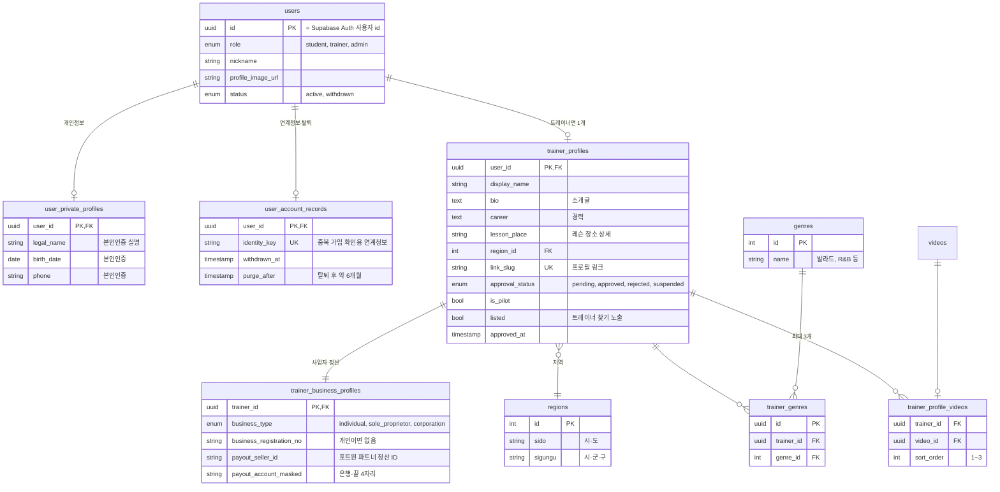
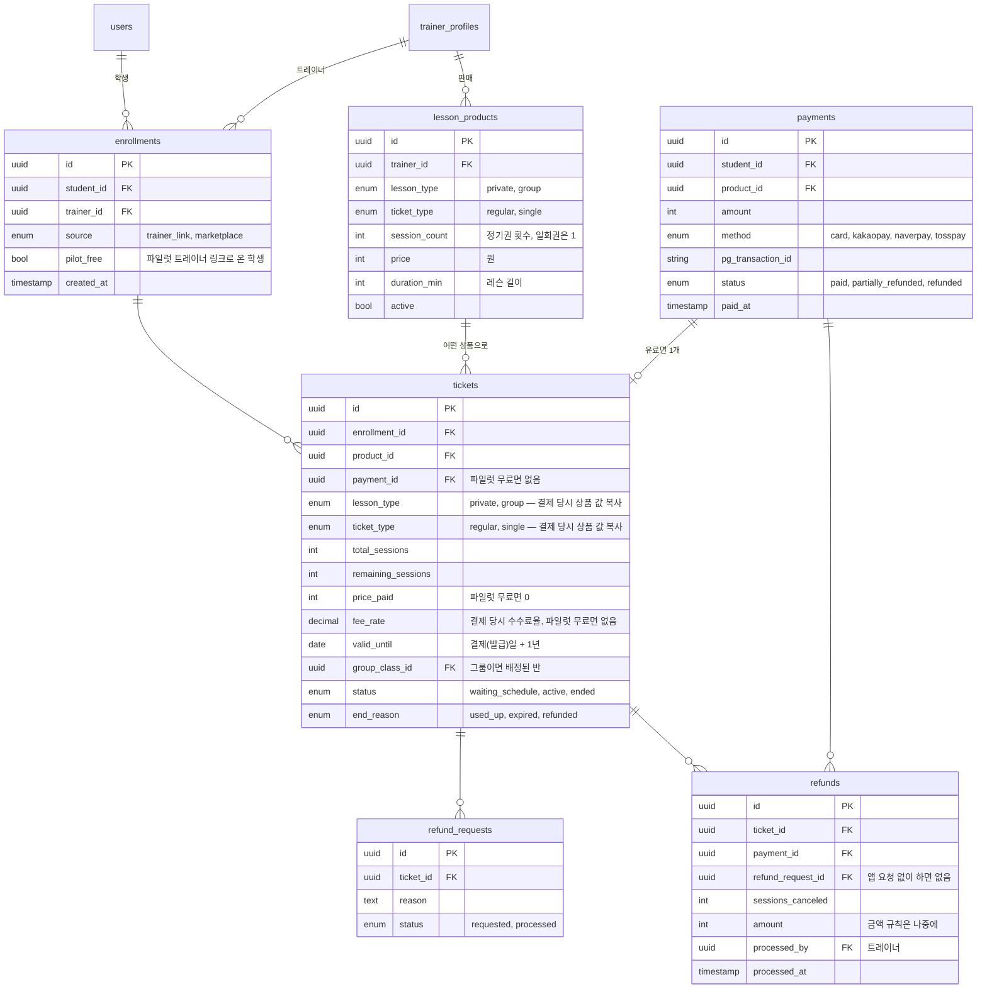
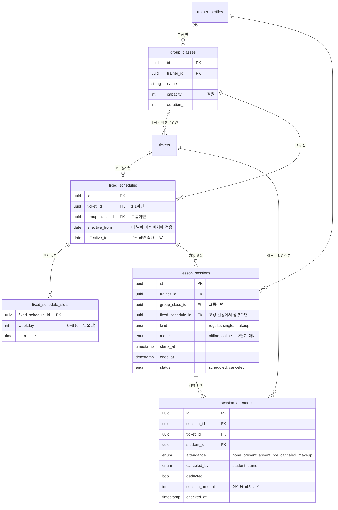
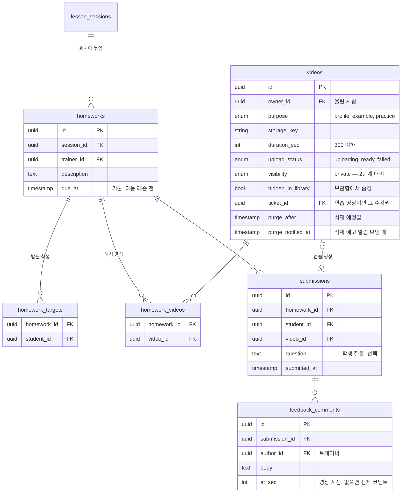
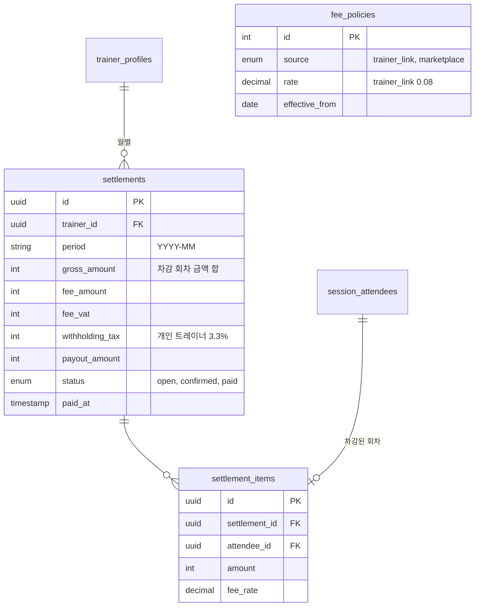
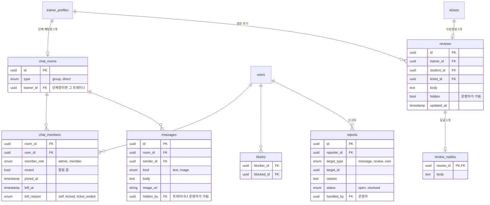
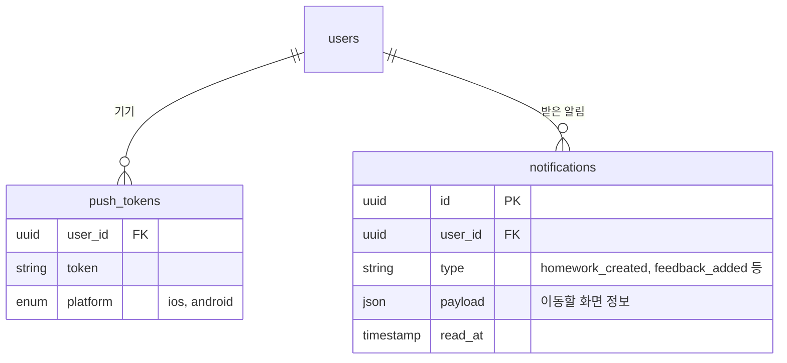

# 보컬 레슨 플랫폼 데이터 모델 (ERD) — 1단계

- 상태: 초안
- 기준 문서: `docs/prd.md`(PR #2), `docs/screens.md`(PR #3). 괄호 안의 `PAY-03` 같은 ID가 그 테이블이 다루는 요구사항이다.
- 이 문서는 논리 모델이다. 어떤 DB를 쓸지, 타입을 정확히 무엇으로 할지는 기술 문서에서 정한다.
- 표기
  - 테이블·컬럼의 영문 이름과 enum 값은 코드(화면, API, DB)에서도 그대로 쓴다.
  - **(제안)**: PRD에 없고 Claude가 채워 넣은 항목.
  - **[결정 n]**: 이 문서 끝 "결정 필요" n번과 연결된 항목.
  - 모든 테이블에는 `id`(PK)와 `created_at`이 있다고 보고, 다이어그램에서는 꼭 필요할 때만 적는다. 다른 테이블과 1:1인 테이블(`trainer_profiles`, `user_private_profiles`, `user_account_records`, `trainer_business_profiles`)은 `id` 대신 가리키는 FK가 PK다.
  - `id`는 uuid다. 운영자·마이그레이션이 미리 넣는 기준 데이터(`regions`, `genres`, `fee_policies`)만 int 자동 증가다.
  - DB의 enum 타입 이름은 `<테이블>_<컬럼>`이다. 예: `users_role`, `trainer_profiles_approval_status`. 같은 값을 쓰는 컬럼도 테이블마다 타입을 따로 둔다(예: `lesson_products_lesson_type`과 `tickets_lesson_type`). enum 값은 이 문서와 `packages/shared/src/domain.ts`를 따른다.
  - enum 컬럼의 주석에는 값을 쉼표로 적고, 설명은 `—` 뒤에 붙인다.

## 1. 용어와 영문 이름

| 용어 | 테이블 |
|---|---|
| 사용자 (학생·트레이너·운영자) | `users` |
| 사용자 개인정보 (본인인증 실명·생년월일·휴대폰) | `user_private_profiles` |
| 사용자 계정 기록 (연계정보·탈퇴 일정) | `user_account_records` |
| 트레이너 프로필 | `trainer_profiles` |
| 트레이너 사업자·정산 정보 | `trainer_business_profiles` |
| 레슨 상품 | `lesson_products` |
| 수강 관계 | `enrollments` |
| 결제 | `payments` |
| 수강권 | `tickets` |
| 그룹 반 | `group_classes` |
| 고정 일정 | `fixed_schedules` |
| 레슨 회차 | `lesson_sessions` |
| 회차 참여·출결 | `session_attendees` |
| 숙제 | `homeworks` |
| 연습 영상 제출 | `submissions` |
| 피드백 | `feedback_comments` |
| 영상 (프로필·예시·연습) | `videos` |
| 환불 요청 / 환불 | `refund_requests` / `refunds` |
| 정산 | `settlements`, `settlement_items` |
| 채팅방 (단체·1:1) | `chat_rooms`, `chat_members`, `messages` |
| 후기 / 후기 답글 | `reviews` / `review_replies` |
| 신고 / 차단 | `reports` / `blocks` |
| 푸시 기기 토큰 / 알림 | `push_tokens` / `notifications` |

## 2. 계정·트레이너

- 한 계정은 하나의 역할만 가진다(`role`). 운영자 계정도 따로 쓴다. (AUTH-02, PRD 4장)
- 로그인 수단(카카오·구글·애플)은 Supabase Auth가 저장한다(`auth.identities`). `users.id`는 Supabase Auth 사용자 id와 같다. 운영자가 로그인 수단을 봐야 하면 서버 함수로 조회한다. (AUTH-01, ADM-07)
- 남에게 보이면 안 되는 정보는 1:1 별도 테이블에 둔다. 다른 사용자에게는 `users`(닉네임·프로필 사진 등)와 `trainer_profiles`만 보인다. (AUTH-06, CHAT-04)
  - `user_private_profiles`: 본인인증 결과 중 실명·생년월일·휴대폰 번호. 본인, 운영자, 자기 학생의 트레이너가 본다. "자기 학생"은 그 트레이너의 `tickets` 중 `status`가 `waiting_schedule` 또는 `active`인 것이 있는 학생이다(3장의 테이블이 생긴 뒤 구현). (AUTH-03, AUTH-09, ADM-07, 화면 A-01, T-08)
  - `user_account_records`: 중복 가입 확인용 연계정보와 탈퇴 일정. 본인과 운영자만 본다. 트레이너는 자기 학생 것도 보지 못한다. (AUTH-03, AUTH-08, AUTH-09)
  - 두 테이블 모두 클라이언트가 쓰지 않고 서버가 쓴다. 본인인증을 하지 않는 운영자 계정에는 행이 없을 수 있다.
  - `trainer_business_profiles`: 사업자 유형과 정산 정보. 그 트레이너와 운영자만 본다. `business_type`, `business_registration_no`는 `pending` 동안만 트레이너가 고치고, 그 뒤에는 운영자만 고친다. `payout_seller_id`, `payout_account_masked`는 서버가 쓴다. (AUTH-04, 화면 T-23, A-01, A-05)
- 본인인증 결과로 만 19세 미만이면 `users`를 만들지 않는다. (AUTH-03)
- 본인인증 결과 중 실명, 생년월일, 휴대폰 번호, 중복 가입 확인용 연계정보만 저장한다. 저장 범위는 개인정보 처리방침에 적는다.
- 탈퇴하면 `users.status = withdrawn`, `user_account_records`의 `withdrawn_at = 탈퇴일`, `purge_after = 탈퇴일 + 약 6개월`로 두고, 그날이 지나면 계정 정보와 영상을 지운다. 영상은 용도(`profile`·`example`·`practice`)와 관계없이 지운다(5장). (PM 결정 2026-11-21) 결제·정산 기록은 법정 기간 동안 남긴다. (AUTH-08)
- 승인 전(`pending`)에는 `link_slug`로 프로필을 열 수 없다. 목록에는 `approved`이면서 `listed = true`인 트레이너만 나온다. (AUTH-05, MKT-01, MKT-07)
- `link_slug`는 서버가 만들고 아무도 바꿀 수 없다. (TRN-02)
- 정지(`suspended`)된 트레이너도 자기 `trainer_profiles`, `trainer_genres` 등 프로필 내용을 고칠 수 있다. 공개 범위만 좁아진다. (ADM-02)
- 탈퇴한 사용자(`users.status = withdrawn`)는 자기 정보를 고칠 수 없다: `users`의 닉네임·프로필 사진, 트레이너 프로필·장르·사업자 정보 모두. (AUTH-07)
- 정지(`suspended`)된 트레이너의 프로필은 본인, 운영자, 그 트레이너와 수강 관계(`enrollments`)가 있는 학생만 본다. 프로필 화면(S-01)에 함께 나오는 장르(`trainer_genres`)와 판매 중인 상품(`lesson_products`)도 같은 기준이다. (ADM-02)
- 프로필 영상은 3개까지다. (TRN-07)
- `trainer_profile_videos` (TRN-07, ADM-02, AUTH-07)
  - 트레이너가 자기 프로필 영상을 직접 붙이고, 빼고, `sort_order`를 바꾼다. 정지된 트레이너도 되고, 탈퇴한 트레이너는 못 한다. 영상 행(`videos`)은 서버가 만든다(5장).
  - 그 트레이너 프로필을 볼 수 있는 사람(로그인하지 않은 사용자 포함)이 본다. 정지된 트레이너의 것은 프로필과 같은 기준(본인·운영자·수강 관계 학생)이다.
  - DB 제약: 영상은 그 트레이너가 올린 `purpose = profile`, `upload_status = ready` 영상이다. `sort_order`는 1~3이고 트레이너마다 겹치지 않으며, 같은 영상은 한 번만 붙는다.
  - 프로필에서 빼도 `videos` 행은 지우지 않는다. 붙지 않은 프로필 영상은 올린 트레이너와 운영자만 본다.
- 지역은 시·도와 시·군·구 두 단계이고, 전국의 시·군·구를 모두 넣는다. 시·군·구는 시 단위로 두고 일반구(예: 성남시 분당구)로 나누지 않는다. 시·군·구가 없는 세종은 `sigungu = '세종특별자치시'`로 둔다. (TRN-08의 예시 "경기 성남시")
- 트레이너의 사업자 유형(`trainer_business_profiles.business_type`)을 저장한다. 사업자등록이 없는 개인(`individual`)도 받는다. 사업자이면 사업자등록번호를 함께 저장한다.
- 정산 계좌번호 전체는 저장하지 않는다. 트레이너가 계좌를 입력하면 서버가 PG 지급대행에 셀러로 등록하고, PG가 준 셀러 ID(`payout_seller_id`)와 "은행명·끝 4자리"(`payout_account_masked`)만 저장한다. 매달 지급할 때는 셀러 ID와 금액만 PG에 보낸다. 계좌를 바꾸면 PG에 다시 등록한다. PG별 등록 절차는 계약할 때 확인한다.

## 3. 상품·결제·수강권

- `payments`는 학생 본인과 운영자만 본다. 트레이너는 학생이 낸 금액을 `tickets.price_paid`로 본다. (PAY-03)
- 수강 관계는 학생·트레이너 쌍마다 하나다. 그 트레이너와 처음 결제(파일럿 링크면 가입)할 때 생기고, 그때의 유입 경로를 `source`에 남긴다. (PAY-04, MKT-06)
- 파일럿 무료는 `pilot_free = true`인 수강 관계에만 적용된다. 파일럿 트레이너가 목록으로 받은 학생은 `source = marketplace`, `pilot_free = false`라서 결제한다. (PLT-02, PLT-07)
- 수강권은 결제 당시의 상품 내용(유형, 횟수, 가격)과 수수료율을 복사해 둔다. 트레이너가 나중에 가격을 바꾸거나 수수료율이 바뀌어도 이미 산 수강권은 그대로다. (제안)
- 같은 학생이 같은 트레이너의 1:1과 그룹 수강권을 동시에 가질 수 있다. (PAY-08)
- 정기권은 결제 직후 `waiting_schedule`, 고정 일정이 들어오면 `active`, 횟수 소진·만료·환불이면 `ended`. (PAY-05, 화면 S-06)
- 환불하면 남은 회차가 취소되고 `remaining_sessions`가 0이 된다. 금액 계산 규칙은 나중에 정한다. (PAY-09~11)
- 재결제하면 새 수강권이 생긴다. 1:1이면 기존 고정 일정을 새 수강권에 이어 붙여 회차를 만들고, 그룹이면 같은 그룹 반에 배정한다. (PAY-07)
- 파일럿 무료 수강권은 트레이너가 `is_pilot = true`이고 수강 관계가 `pilot_free = true`일 때만 발급할 수 있다. 파일럿이 해제되면 이미 발급된 수강권은 그대로 쓰고, 새 수강권은 결제해야 한다. (PLT-03, PLT-05)
- 파일럿 무료 수강권은 결제가 없어 복사할 수수료율이 없으므로 `fee_rate`를 비워 둔다. `price_paid = 0`이라 정산 항목도 생기지 않는다. (PLT-03, STL-06)
- 상품은 지우지 않는다. 판매를 멈출 때는 `active = false`로 두고, 비활성 상품은 그 트레이너와 운영자만 본다. (TRN-03)
- 상품 값: `session_count` ≥ 1, `price` > 0, `duration_min` > 0이고, 일회권(`single`)은 `session_count = 1`이다. (TRN-03, TRN-05, TRN-06)
- 수강권 값: `total_sessions` ≥ 1, 0 ≤ `remaining_sessions` ≤ `total_sessions`, `price_paid` ≥ 0, 일회권은 `total_sessions = 1`, `end_reason`은 `status = ended`일 때만 있다. 수강권의 상품·그룹 반은 그 수강 관계의 트레이너 것이다. DB는 이 범위만 검사하고 금액을 계산하지 않는다. (PAY-03)
- 환불 요청은 결제한(`payment_id` 있음) `waiting_schedule`·`active` 수강권에만 낼 수 있다(파일럿 무료·끝난 수강권 제외). 수강권마다 처리 대기(`requested`)인 것이 하나까지다. 학생은 요청을 철회하거나 고치지 않고, `processed`로 바꾸는 것은 서버다. (PAY-10, PAY-11)

## 4. 일정·출결

- 그룹 반은 정원(`capacity`)이 차면 학생을 더 배정할 수 없다. 학생은 그룹 수강권을 결제할 수 있고, 트레이너가 자리가 있는 반에 배정한다.
  - 정원은 그 반에 끝나지 않은 수강권으로 배정된 **서로 다른 학생 수**로 센다. 재결제(PAY-07)로 같은 학생의 수강권이 둘이어도 한 명이다. 정원을 배정된 학생 수보다 작게 줄일 수 없다. (TRN-04)
  - 반은 상품과 연결하지 않는다. 같은 반에 회차가 다른 수강권이 섞일 수 있고, 배정할 수 있는 것은 그 트레이너의 `lesson_type = group`이고 `ended`가 아닌 수강권이다. (TRN-04)
  - 배정은 트레이너가 수강권의 `group_class_id`를 바꾸는 것이다. 반은 그 트레이너, 운영자, 그 반에 배정된 수강권이 있는 학생만 본다. (TRN-04)
  - 수강권이 배정된 반은 지울 수 없다. 배정된 수강권이 없으면 트레이너가 지울 수 있다. (TRN-04)
- 고정 일정은 1:1이면 수강권에, 그룹이면 그룹 반에 붙는다. 주 여러 요일은 `fixed_schedule_slots` 여러 줄이다. (SCH-01, TRN-04)
- 고정 일정을 수정하면 기존 일정의 `effective_to`를 수정일로 닫고 새 일정을 만든다. 수정일 이후의 `scheduled` 회차만 지우고 새 일정으로 다시 만든다. 지난 회차와 출결은 그대로 남는다. (SCH-04)
- 회차 하나에 학생이 여러 명일 수 있어서(그룹), 출결은 회차가 아니라 `session_attendees`에 학생별로 둔다. (ATT-03)
- 출결과 차감 (ATT-01, ATT-02)
  - `present`(출석), `absent`(결석), `makeup`(보강): `deducted = true`, 수강권 `remaining_sessions` 1 감소
  - `pre_canceled`(사전 취소): 차감 없음. 학생 취소는 레슨 24시간 전까지만 된다. (SCH-05)
  - 트레이너가 회차를 취소하면 회차 `status = canceled`, 참여 학생 전원 `pre_canceled`. (SCH-06)
- 보강은 `kind = makeup`인 회차다. 그룹 반 학생도 개별 보강 회차로 잡는다. (SCH-08)
- `session_amount`는 차감 시점에 채운다. 기본값은 `floor(price_paid ÷ total_sessions)`이고, 그 수강권의 마지막 차감(`remaining_sessions`가 0이 되는 차감)에는 나머지 `price_paid − 기본값 × total_sessions`를 더한다. 그래서 한 수강권의 회차 금액을 모두 더하면 결제 금액과 같다. 정산은 이 값을 모은다. 계산은 `packages/shared`의 함수로 한다. (STL-02)
- 일회권은 `kind = single` 회차 하나다. (SCH-02)
- 시각과 요일 (SCH-01, SCH-09)
  - 회차 `starts_at`·`ends_at`은 시간대가 있는 시각(Postgres `timestamptz`)으로 저장한다.
  - 요일, 고정 일정의 `start_time`·`effective_from`·`effective_to`, 화면 표시는 Asia/Seoul 기준이다.
  - `weekday`는 0 = 일요일 ~ 6 = 토요일이다(Postgres `extract(dow)`, JavaScript `Date.getDay()`와 같은 기준).
- 쓰기 경로 (SCH-01~SCH-08, ATT-02~ATT-05, STL-02)
  - 고정 일정·요일, 회차 만들기·취소·삭제, 참여 행(출결 체크, 학생 사전 취소, `deducted`, `session_amount`)은 서버 함수가 쓴다.
  - 클라이언트가 직접 쓰는 것은 트레이너의 회차 시간(`starts_at`·`ends_at`) 변경뿐이다.
- 학생은 자기 참여 행이 있는 회차와 자기 참여 행만 본다. 같은 반 다른 학생의 출결은 보지 않는다. (SCH-09, ATT-05)
- 트레이너는 자기 회차 중 `status = scheduled`이고 차감된 참여 행이 없는 회차의 시간만 바꾼다. 정지된 트레이너도 바꿀 수 있고, 탈퇴한 트레이너는 못 바꾼다. (SCH-03, ADM-02, AUTH-07)
- 회차는 차감된 참여 행이 없을 때만 서버가 지우고, 참여 행도 함께 지워진다. 차감된 참여 행이 있는 회차는 지울 수 없다. (SCH-04, STL-02)
- DB 제약으로 값의 범위와 관계를 지킨다. 출결에 따른 차감 여부와 금액은 DB가 계산·검사하지 않는다(공유 규칙 함수가 한다). (SCH-01, SCH-02, ATT-03, STL-02)
  - 고정 일정은 `ticket_id`·`group_class_id` 중 정확히 하나를 가리키고, `ticket_id`는 1:1 정기권만이다. `effective_to`는 비었거나 `effective_from` 이후다.
  - 같은 고정 일정에 같은 요일·시작 시각은 하나다. 회차는 `ends_at` > `starts_at`이고 `mode = offline`만이다.
  - `kind = regular`이면 `fixed_schedule_id`가 있고, `single`·`makeup`이면 `fixed_schedule_id`·`group_class_id`가 없다. 회차의 트레이너·반은 고정 일정의 것과 같다.
  - 참여 행은 (회차, 학생)마다 하나이고, 수강권의 학생·트레이너·유형이 회차와 맞아야 한다. `canceled_by`는 `pre_canceled`일 때만 있다. `session_amount`는 0 이상이고 `deducted = false`이면 비어 있다.

## 5. 숙제·영상·피드백

- 숙제는 회차에 묶이고, 한 회차에 여러 개 낼 수 있다. 받는 학생은 `homework_targets`에 적는다. 1:1이면 한 명, 그룹 전체면 반의 학생 모두, 일부면 고른 학생만. (HW-01, HW-03)
- 예시 영상은 없어도 된다. 트레이너의 영상 보관함은 `purpose = example`이고 `owner_id`가 그 트레이너인 영상 목록이다. 숨겨도 이미 붙인 숙제에서는 보인다. (HW-02, HW-04, HW-05, 화면 T-16)
- 숙제 상태는 따로 저장하지 않는다. 그 학생의 `submissions`가 있으면 "제출됨", 없으면 "미제출"이다. 여러 번 제출하면 여러 줄이 쌓인다. (HW-07, HW-11)
- 연습 영상 없이는 제출을 만들 수 없다(`video_id` 필수). (HW-06)
- 시점 코멘트는 `at_sec`가 있는 피드백, 텍스트 코멘트는 `at_sec`가 없는 피드백이다. (HW-10)
- 영상 하나는 제출 0~1개에 쓰인다. 제출 전 연습 영상, 예시 영상, 프로필 영상은 제출이 없다. (HW-06)
- 보관 기한 (HW-14, AUTH-08)
  - 연습 영상은 `ticket_id`로 수강권과 연결한다. 수강권이 끝나면(`ended`) `purge_after = 종료일 + 1년`으로 정하고, 그 한 달 전에 학생에게 삭제 예고 알림을 보낸 뒤(`purge_notified_at`) 날짜가 되면 지운다.
  - `purge_after`는 서버가 수강권을 끝낼 때 계산해 넣는다. `tickets`에 종료 시각 컬럼을 따로 두지 않는다. 날짜 계산은 공유 규칙 함수가 하고, DB는 계산·기본값·트리거 없이 넣은 값을 그대로 저장한다.
  - 예시 영상과 프로필 영상은 수강권 종료 규칙으로는 지우지 않는다. 올린 사람이 탈퇴하면 용도와 관계없이 탈퇴 규칙(약 6개월, 2장)을 따르고, 연습 영상은 두 날짜 중 빠른 날을 쓴다. 그래서 `purge_after`는 용도와 관계없이 넣을 수 있다. (탈퇴 부분은 PM 결정 2026-11-21)
  - 수강권 종료·탈퇴로 영상·제출·피드백 행이 바로 지워지거나 바뀌지 않는다.
- 숙제 영상은 해당 트레이너, 숙제를 받은 학생, 운영자만 볼 수 있다. 그룹 숙제라도 다른 학생의 제출은 보이지 않는다. (HW-12, NFR-04) `videos` 행 기준으로는 다음과 같다.
  - 올린 사람은 자기 영상을 상태와 관계없이 본다. 운영자는 모두 본다.
  - 예시 영상: 올린 트레이너, 그 영상이 붙은 숙제의 대상 학생. 보관함에서 숨겨도 이미 붙은 숙제의 대상 학생은 계속 본다.
  - 연습 영상: 올린 학생, 그 영상이 붙은 제출의 숙제 트레이너. 제출에 붙기 전에는 올린 학생과 운영자만 본다.
  - 수강권이 끝난 뒤에도 `purge_after`까지 해당 트레이너와 학생은 지난 숙제·제출·피드백과 영상을 본다. (PM 결정 2026-11-21)
  - 프로필 영상: 2장 `trainer_profile_videos` 기준.
- 학생은 자기가 대상인 숙제와 그 예시 영상 연결, `homework_targets`의 자기 줄만 본다. 같은 숙제를 받은 다른 학생 목록은 보지 않는다. (HW-03, HW-12)
- 쓰기 경로 (HW-01~HW-13, NFR-03)
  - `videos` 행 만들기·지우기와 `upload_status`·`duration_sec`·`storage_key`·`ticket_id`·`purge_after`·`purge_notified_at`은 서버가 쓴다(업로드·업로드 완료 처리).
  - 클라이언트가 직접 쓰는 것: 트레이너의 자기 예시 영상 `hidden_in_library`, 트레이너의 숙제 만들기와 `description`·`due_at` 고치기, 대상·예시 영상 연결 만들기, 학생의 제출 만들기, 트레이너의 피드백 달기. 직접 쓰기는 모두 탈퇴하지 않은 사용자만 한다. (AUTH-07)
  - 숙제의 `session_id`·`trainer_id`는 바꾸지 않는다. 대상·예시 영상 연결·제출·피드백은 고치거나 지우지 않는다(제출은 HW-07로 남긴다).
  - 정지된 트레이너도 기존 학생에게 숙제를 내고 피드백을 단다. `docs/prd.md` 결정 필요 3이 정해지면 다시 본다. (ADM-02)
- 마감(`due_at`)이 지나도, 수강권이 끝난 뒤에도 대상 학생은 제출할 수 있다. 늦음 상태는 없다. `submitted_at`은 DB가 넣는다. (HW-07, HW-11)
- DB 제약으로 값의 범위와 관계를 지킨다(서버 쓰기에도 걸린다). `purge_after` 날짜 계산은 검사하지 않는다. (HW-01~HW-10, TRN-07)
  - `videos`: `duration_sec`은 비었거나 1~300이고, `ready`이면 `duration_sec`·`storage_key`가 있다. `storage_key`는 고유하다. `ticket_id`는 `practice`일 때만 있고 반드시 있으며, 그 수강권의 학생이 `owner_id`다. `profile`·`example`은 트레이너, `practice`는 학생이 올린다. `purge_notified_at`은 `purge_after`가 있을 때만 있다. `visibility`는 `private`만이다(9장).
  - `homeworks`: `trainer_id`는 회차의 트레이너이고, `canceled` 회차에는 만들 수 없다. `description`은 비어 있지 않고 `due_at`은 있다.
  - `homework_targets`: 학생은 그 회차에 참여 행이 있는 학생이고, (숙제, 학생)은 하나다.
  - `homework_videos`: 영상은 숙제 트레이너가 올린 `example` 영상이고, (숙제, 영상)은 하나다.
  - `submissions`: 영상은 제출한 학생이 올린 `practice`·`ready` 영상이고, 그 `ticket_id`는 그 학생의 숙제 회차 참여 행의 수강권이다. 학생은 숙제 대상이다. 영상 하나는 제출 하나에만 쓰인다.
  - `feedback_comments`: `author_id`는 숙제 트레이너다. `body`는 비어 있지 않고, `at_sec`은 비었거나 0 이상 영상 `duration_sec` 이하다.

## 6. 정산

- 차감된 출결(`deducted = true`) 한 줄이 정산 항목 한 줄이 된다. 그 달에 차감된 항목을 모아 다음 달에 지급한다. (STL-02, STL-04)
- 수수료율은 유입 경로별로 `fee_policies`에 두고, 결제할 때 그 값을 수강권의 `tickets.fee_rate`에 복사한다. `tickets`는 `fee_policies`를 FK로 가리키지 않는다(3장 "결제 당시의 수수료율을 복사해 둔다"). 마켓플레이스 수수료율은 아직 정하지 않았다(`docs/idea.md` 결정 필요 4). (STL-03)
- 파일럿 무료 수강권(`price_paid = 0`)은 정산 항목을 만들지 않는다. (STL-06)
- `fee_policies`는 운영자만 읽고, 쓰기는 마이그레이션·서버만 한다(수수료율 설정 화면 없음). `trainer_link` 0.08은 마이그레이션의 기준 데이터로 넣는다. `marketplace` 행은 결정 필요 4가 정해질 때까지 운영 데이터에 넣지 않는다(개발용 seed에만 더미). 같은 `source`·`effective_from` 행은 하나다. (STL-03)
- 개인 트레이너(`trainer_business_profiles.business_type = individual`)에게 지급할 때는 3.3%를 원천징수해 `withholding_tax`에 기록하고 그만큼 빼고 지급한다. (STL-07)
- 정산이 `confirmed`가 되면 그 달의 출결은 더 고칠 수 없다. (ATT-06)
- 트레이너가 끝까지 체크하지 않은 출결(`none`)은 자동으로 바꾸지 않고, 정산되지 않는다.

## 7. 채팅·후기·신고

- 단체 채팅방은 트레이너당 하나(`type = group`), 1:1 대화는 두 사람당 하나(`type = direct`)다. (CHAT-01, DM-01)
- 단체 채팅방 참여: 유효한 수강권이 생기면 들어가고, 모든 수강권이 끝나면 `left_reason = ticket_ended`로 나간다. 트레이너는 `member_role = admin`. (CHAT-02, CHAT-03, CHAT-06)
- 1:1 대화를 열 수 있는 사이 (DM-01~03)
  - 학생 → 트레이너: 수강 관계가 없어도 됨 (문의)
  - 트레이너 → 자기 학생, 자기에게 문의한 학생
  - 학생 ↔ 학생: 같은 단체 채팅방에 있을 때
  - 열 수 있는 사이인지는 서버 함수가 `packages/shared` 규칙으로 판정한다. DB는 아래 "DB 제약"의 구조만 지킨다.
- 차단하면 그 사람의 메시지가 보이지 않고, 새 1:1 대화도 열 수 없다. (CHAT-07, DM-05) (차단 효과는 제안)
- 후기는 수강권마다 하나다. 그 수강권으로 출석이나 보강이 1회 이상 있어야 쓸 수 있다. (REV-02)
- 운영자는 신고된 1:1 대화만 본다. 신고(`reports`)가 있는 메시지의 대화방만 운영자 화면에서 열린다. (ADM-07)
- enum 타입: `chat_rooms_type`, `chat_members_member_role`, `chat_members_left_reason`, `messages_kind`, `reports_target_type`, `reports_status`. 값은 위 다이어그램과 `packages/shared/src/domain.ts`를 따른다.
- 참여 행 (CHAT-02, CHAT-03, CHAT-06)
  - (방, 사용자)마다 한 줄이다. 다시 들어오면 서버가 그 줄의 `joined_at`을 새로 쓰고 `left_at`·`left_reason`을 비운다.
  - "유효한 수강권"은 끝나지 않은(`waiting_schedule`·`active`) 수강권이다. 결제 직후(일정 대기)에도 들어간다(화면 S-03).
  - 단체 채팅방의 `member_role = admin`은 그 방의 트레이너 한 명뿐이고, 학생은 `member`다. 1:1 대화의 두 사람은 `member`다.
  - 학생은 단체 채팅방에서 스스로 나간다(`left_reason = self`). 1:1 대화에는 나가기가 없다(화면 S-21). 트레이너는 자기 단체 채팅방을 나가지 않는다.
  - 트레이너는 자기 단체 채팅방의 학생을 내보낸다(`kicked`). `ticket_ended`는 서버만 쓴다. 나간 줄을 다시 참여 상태로 바꾸는 것은 서버만 한다.
- 열람 범위 (CHAT-04, DM-01, ADM-07, AUTH-06)
  - 방과 메시지는 그 방의 현재 참여자(`left_at`이 빈 줄)가 본다. 메시지는 자기 `joined_at` 이후의 것만 본다. 나가면 그 방의 방·메시지를 보지 않는다(자기 참여 행은 계속 본다).
  - 참여자 목록(`chat_members`)은 같은 방의 현재 참여자가 본다. 다른 사람에게는 `users`의 닉네임·프로필 사진만 보인다(AUTH-06).
  - 가린 메시지(`hidden_by` 있음)는 운영자와 그 단체 채팅방의 트레이너만 본다.
  - 차단한 사람에게는 차단당한 사람이 보낸 메시지가 보이지 않는다(DB 정책으로 거른다). 차단당한 사람에게는 변화가 없다.
  - 운영자는 신고된 메시지가 있는 방(단체·1:1)의 방·참여자·메시지를 본다. 신고가 없는 단체 채팅방은 보지 않는다(결정 로그 2026-11-22).
- 후기 열람 (REV-03, ADM-02)
  - 후기와 답글은 그 트레이너 프로필을 볼 수 있는 사람(로그인하지 않은 사용자 포함)이 본다. 정지된 트레이너의 것은 프로필과 같은 기준(본인·운영자·수강 관계 학생)이다.
  - 가린 후기(`hidden = true`)와 그 답글은 작성자와 운영자만 본다.
- 차단·신고·알림·기기 토큰은 본인만 본다(차단은 차단한 사람, 신고는 신고한 사람). 운영자는 신고를 모두 본다.
- 쓰기 경로 (CHAT-03~08, DM-01~06, REV-02~06, NOTI-01, NOTI-02, ADM-04, NFR-02)
  - 서버가 쓴다: 채팅방 만들기, 참여 행 만들기·다시 들어오기·`ticket_ended`, 메시지 보내기(금칙어 필터, `docs/tech-stack.md` 3.5), 후기 쓰기·고치기와 답글 쓰기(금칙어 필터, NFR-02), 기기 토큰, 알림 만들기.
  - 클라이언트가 직접 쓴다: 자기 참여 행의 `muted`와 나가기, 트레이너의 내보내기, 트레이너(자기 단체 채팅방)·운영자의 메시지 가리기(`hidden_by`), 작성자의 후기 지우기, 운영자의 후기 가리기(`hidden`), 차단하기, 신고하기, 운영자의 신고 처리(`status`·`handled_by`), 자기 알림 읽음(`read_at`).
  - 직접 쓰기는 모두 탈퇴하지 않은 사용자만 한다(AUTH-07). 정지된 트레이너도 기존 단체 채팅방·1:1 대화·답글을 계속 쓴다. `docs/prd.md` 결정 필요 3이 정해지면 다시 본다. (ADM-02)
  - 고치거나 지우지 않는 것(화면에 없음): 메시지 수정·삭제, 가리기 되돌리기, 답글 수정·삭제, 차단 해제, 신고 철회. 후기를 지우면 답글도 지워진다.
- DB 제약으로 값의 범위와 관계를 지킨다(서버 쓰기에도 걸린다).
  - `chat_rooms`: `group`이면 `trainer_id`가 있고 트레이너마다 하나, `direct`이면 `trainer_id`가 없다.
  - `chat_members`: `direct` 방은 서로 다른 두 사람까지이고, 같은 두 사람의 1:1 대화는 하나다. 단체 채팅방에 들어오는(다시 들어오는) 학생은 그 트레이너의 끝나지 않은 수강권이 있다. `left_reason`은 `left_at`이 있을 때만 있고 반드시 있다.
  - `messages`: 보내는 사람은 그 방의 현재 참여자다. `text`이면 `body`가 비어 있지 않고 `image_url`이 없다. `image`이면 `image_url`이 있다. `hidden_by`는 그 단체 채팅방의 트레이너나 운영자다.
  - `reviews`: 수강권마다 하나. `trainer_id`·`student_id`는 그 수강권의 트레이너·학생이고, 그 수강권에 `present`·`makeup` 참여 행이 있다. `body`는 비어 있지 않다. `updated_at`은 DB가 넣는다.
  - `review_replies`: 그 후기의 트레이너만 쓰고, `body`는 비어 있지 않다.
  - `blocks`: (차단한 사람, 차단당한 사람)은 하나이고 자기 자신은 차단하지 않는다.
  - `reports`: 대상은 신고한 사람이 볼 수 있는 메시지·후기·사용자이고, 자기 자신과 자기 글은 신고하지 않는다. 같은 사람이 같은 대상에 처리 대기(`open`) 신고를 둘 내지 않는다. `reason`은 비어 있지 않다. `resolved`이면 `handled_by`(운영자)가 있다. 볼 수 없는 대상과 없는 대상의 신고는 같은 오류로 막는다(#38).

## 8. 알림

- 푸시를 보낸 기록을 `notifications`에 남겨 알림 목록(화면 C-06)에 쓴다. (NOTI-01, NOTI-02)
- 채팅방·1:1 대화 알림 끄기는 `chat_members.muted`로 한다. (CHAT-08, DM-06)
- enum 타입: `push_tokens_platform`. `notifications.type`은 enum이 아니라 문자열이고, 값 목록은 알림 서버 함수 이슈에서 `packages/shared`에 둔다.
- 기기 토큰은 서버가 쓴다. 한 기기에서 다른 계정으로 로그인하면 이전 사용자의 줄을 정리해야 해서 클라이언트가 직접 쓰지 않는다. `token`은 고유하다. 본인만 자기 토큰을 본다. (NOTI-01)
- 알림은 서버가 만든다. 받은 사람만 보고, 받은 사람은 `read_at`만 채운다(비어 있을 때 한 번). 알림은 지우지 않는다(화면 C-06). (NOTI-02)

## 9. 2단계 대비

| 2단계 기능 | 1단계에 미리 둔 것 |
|---|---|
| 기본기 연습 영상 공개 범위 | `videos.visibility` (1단계는 항상 `private`) |
| 기본기 콘텐츠 | 영상 보관함을 숙제와 분리된 `videos`로 저장 |
| 여러 트레이너의 피드백 | `feedback_comments.author_id`가 수강 관계와 무관 |
| 온라인 일회성 클래스 | `lesson_sessions.mode` (1단계는 항상 `offline`) |

- 2단계 기본기 연습 영상은 숙제 제출(`submissions`)이 아니라 별도 테이블에 담을 가능성이 높다. 피드백 테이블을 그때 함께 쓸 수 있도록, 지금은 `feedback_comments`가 `submissions`만 가리키되 2단계에서 대상을 넓힌다. (제안)

## 10. 결정 필요

데이터 모델에 영향을 주는(★) 남은 항목은 다른 문서에서 다루고, 정해지면 이 문서에 반영한다. 이 문서에서 생긴 항목은 아래 "4장 일정·출결", "5장 숙제·영상"에 모았다.

- `docs/prd.md` 결정 필요 3 — 트레이너 정지 시 기존 학생·수강권 처리 (3장. 프로필 공개 범위는 2장에 정했다)
- `docs/idea.md` 결정 필요 2 — 환불 세부 규칙 (`refunds.amount` 계산, 3장)
- `docs/idea.md` 결정 필요 4 — 마켓플레이스 유입 학생의 수수료율 (`fee_policies`의 `marketplace` 값, 6장)

### 4장 일정·출결 — 서버 함수 이슈에서 정할 것 (#32에서 넘김)

- 그룹 반 회차를 몇 개, 언제까지 만드나. SCH-01은 "수강권 횟수만큼"인데 반에는 횟수가 없고 회차가 다른 수강권이 섞인다.
- 반 배정·해제 때 이후 그룹 회차의 참여 행을 누가 어떻게 맞추나(배정은 클라이언트 직접, 결정 로그 2026-11-21).
- 1:1 재결제 때 "기존 고정 일정을 새 수강권에 이어 붙인다"(3장, PAY-07)가 새 `fixed_schedules` 행인지, 기존 일정에 새 수강권 참여 행을 만드는 것인지.
- 1:1 회차 길이(`ends_at`)의 기준(상품 `duration_min` 등).
- 출결 수정(ATT-06) 때 차감 되돌리기와 `session_amount` 재계산(마지막 차감의 나머지). 금액 계산 로직이라 PM 승인이 필요하다.

### 5장 숙제·영상 — 서버 함수 이슈에서 정할 것 (#35에서 넘김)

- 숙제 마감 기본값 "다음 레슨 전"(HW-02)에서 다음 회차가 없을 때(마지막 회차)의 기본값.

### 7·8장 채팅·후기·알림 — 서버 함수 이슈에서 정할 것 (#41에서 넘김)

- 단체 채팅방을 언제 만드나(트레이너 승인 때 / 첫 수강권 때).
- 스스로 나간 학생, 내보내진 학생이 다시 들어오는 조건. CHAT-03은 "다시 등록하면 다시 들어온다"만 정한다.
- 탈퇴한 사용자의 참여 행·1:1 대화 처리(AUTH-08은 단체 채팅방 메시지를 "탈퇴한 사용자"로 표시한다고만 정한다).
- 1:1 대화를 열 수 있는 사이(DM-01~03)와 차단 판정, DM-02 "자기 학생"의 기준(AUTH-09와 같게 볼지).
- 채팅 사진의 저장 위치와 권한(`messages.image_url`). `docs/tech-stack.md`에 정하지 않았다.
- 후기 수(MKT-03, MKT-04)에 가린 후기를 세는지.
- 알림 `type` 값 목록과 `payload` 형식(NOTI-02).
